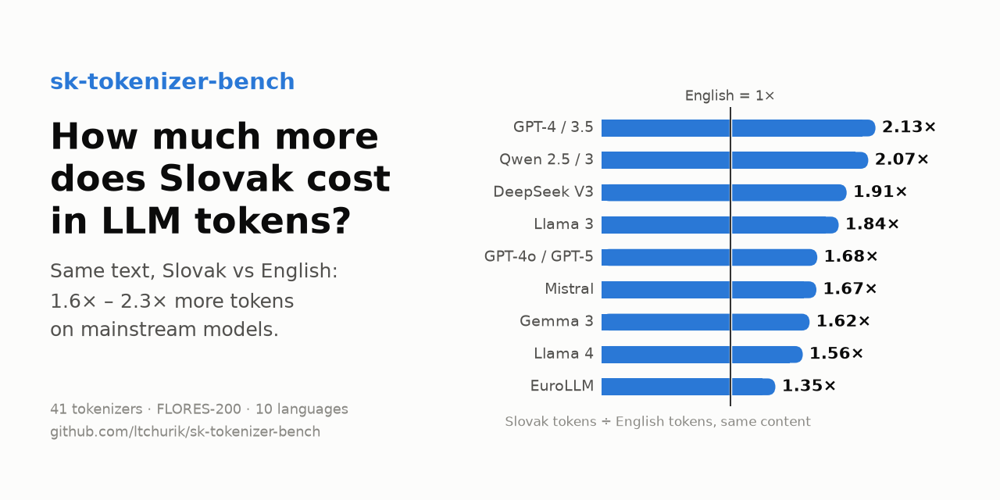

# sk-tokenizer-bench

**How much more do you pay to talk to an LLM in Slovak?** A reproducible benchmark of the Slovak token tax: token counts, characters per token and API cost of Slovak vs English (and eight more Central and Eastern European languages) across 30+ LLM tokenizers.

[](https://ltchurik.github.io/sk-tokenizer-bench/)
[](https://github.com/ltchurik/sk-tokenizer-bench/actions/workflows/bench.yml)
[](https://doi.org/10.5281/zenodo.24092040)
[](LICENSE)
[](requirements.txt)

<p align="center">
  
</p>

**[▶ Online calculator: paste your Slovak text and see its token count and cost](https://ltchurik.github.io/sk-tokenizer-bench/)**

🇸🇰 [Zhrnutie po slovensky](#po-slovensky) · [Kalkulačka online](https://ltchurik.github.io/sk-tokenizer-bench/) · [Results](#results) · [FAQ](#faq) · [Run it yourself](#run-it-yourself) · [Citing](#citing)

Every LLM API bills per token, but tokenizers are trained mostly on English. The same sentence in Slovak — with its diacritics (ľščťžýáíéďňôú), seven cases and rich inflection — gets split into far more tokens. This repo measures exactly how much, across 30+ tokenizers of current models, on 1012 professionally translated FLORES-200 sentences, 1260 segments of real text by genre (social media, speech, fiction, news, EU law) and a hand-written 7-domain corpus, and compares Slovak with Czech, Polish, Hungarian, Slovenian, Croatian, Romanian, Ukrainian and German.

Short answer: **on mainstream models Slovak costs 1.6× to 2.3× more tokens than English** (GPT-4o / GPT-5: 1.68×, Gemma 3: 1.62×, Llama 4: 1.56×). You pay that factor on input *and* output, and a 128k context window holds 40–56 % less Slovak text.

## Takeaways

- **Newer, bigger vocabularies help.** OpenAI's move from `cl100k` (GPT-4) to `o200k` (GPT-4o and later) cut the Slovak penalty from 2.13× to 1.68×; Meta went from 1.84× (Llama 3) to 1.56× (Llama 4), the best mainstream tokenizer measured; Mistral's `tekken` (1.67×) replaced v3 (1.95×).
- **Slovak is pricier than its neighbours.** It costs more than Czech in 30 of 33 distinct tokenizers, and more than Slovenian and Croatian in 28 of 33, even though these languages are close. Among the eight Latin-script languages it ranks in the three most expensive for 26 of 33 tokenizers; only Hungarian is regularly worse. Ukrainian, in Cyrillic, is the most expensive language for 16 of 33 tokenizers (2.96× on GPT-4, 4.58× on Falcon 3), and German is usually the cheapest.
- **Writing without diacritics barely helps on modern models.** Stripping *ľščťž…* removes only 3–13 % of the penalty on Llama 4, Gemma 3, `tekken` and `o200k` (GPT-4o: 1.68× → 1.59×, about 5 % fewer tokens), and the text gets harder to read for both people and models. On older or less multilingual tokenizers diacritics are 17–34 % of the penalty. The rest is morphology and vocabulary. EuroLLM even gets *worse* without diacritics (1.35× → 1.39×), because its vocabulary learned correctly spelled Slovak.
- **Newer is not always better for Slovak.** Gemma 3's tokenizer is slightly *worse* for Slovak than the one in Gemma 1 / 2 (1.62× vs 1.59×), and Mistral Large 4 (1.74×) is worse than the `tekken` tokenizer it follows (1.67×). Qwen 3.8, on the other hand, jumped from 2.07× to 1.64×, now among the best mainstream tokenizers.
- **The 2026 generation** (Qwen 3.8 1.64×, Cohere North 1.69×, Mistral Large 4 1.74×, ERNIE 5.5 1.75×, LFM3 1.84×, GLM-5.3 1.93×, Hunyuan 4 1.95×, Granite 4.2 2.12×) does not beat Llama 4 (1.56×), released in 2025.
- **Multilingual-by-design tokenizers are far better**: mT5 1.29×, EuroLLM 1.35×. Teuken, trained on all 24 EU languages, is great for Czech (1.06×) but not Slovak (1.41×), which suggests Slovak was under-represented in its training data.
- **The gap comes from training data, not from the language.** SlovakBERT (trained on Slovak) needs *fewer* tokens for Slovak than for English (0.77×), and the Czech CSTinyLlama does too (0.92×).
- **Many models reuse someone else's tokenizer.** Apertus and Nemotron Nano 2 use Mistral's `tekken` (same counts on every sentence but one Ukrainian one), Bielik uses Mistral v3, Phi-4-mini and gpt-oss use `o200k`, and Phi-4 and OLMo 2 use `cl100k`, so they inherit those tokenizers' penalties exactly.
- **Results hold across corpora.** On 1260 segments of real text by genre the overall ratio stays within ±0.07× of FLORES for every tokenizer and the ranking barely moves (Spearman 0.98); the hand-written domain corpus lands within ±0.08×.
- **The text type moves the bill more than most tokenizer choices.** News and EU law cost the most (+0.1 to +0.3× above a tokenizer's average), speech transcripts and fiction the least (−0.1 to −0.3×): on GPT-4o, an EU regulation costs 1.74× and a transcribed video 1.50×. Social-media posts sit at or slightly below the average. See [By genre](#by-genre).
- **The Slovak surcharge differs by vendor, not just the list price.** Of the 19 priced models with a measured tokenizer, Qwen 3.8, Mistral and OpenAI add 64–74 % for Slovak, while DeepSeek V4, GLM-5.3, MiniMax M3 and Kimi K3 add 90–101 %. That can cancel a lower list price: `deepseek-v4-pro` is cheaper than `mistral-large-4-0` per English token ($0.66 vs $0.70 input), but the same Slovak text costs slightly more on it ($1.26 vs $1.22 effective). The cheapest options for Slovak input are `qwen3.8-flash`, `mistral-small-4-0-26-03` and `gpt-4o-mini` (about $0.25 per 1M English-token equivalent); see [In dollars](#in-dollars).
- **Closed tokenizers** (current Claude, Gemini) are counted through the vendors' token-counting APIs when a key is available; see [API tokenizers](#api-tokenizers-claude-gemini).

## Results

<!-- results:start -->
<!-- generated by `python bench.py --readme`; do not edit by hand -->

### Slovak vs English

FLORES-200 devtest (1012 professionally translated sentences) with a 95 % bootstrap CI, and the hand-written 7-domain corpus for comparison.

| Tokenizer | sk/en | 95 % CI | sk/en (domain corpus) | chars/token sk | chars/token en |
|---|---|---|---|---|---|
| SlovakBERT (Slovak, Gerulata) | **0.77×** | 0.76–0.78 | 0.71× | 4.51 | 3.49 |
| CSTinyLlama (Czech, BUT-FIT) | **0.92×** | 0.92–0.93 | 0.90× | 3.26 | 3.02 |
| CSMPT (Czech, BUT-FIT) | **0.92×** | 0.92–0.93 | 0.90× | 3.26 | 3.02 |
| mT5 | **1.29×** | 1.28–1.30 | 1.31× | 3.02 | 3.90 |
| EuroLLM | **1.35×** | 1.34–1.36 | 1.37× | 3.38 | 4.57 |
| Teuken (OpenGPT-X) | **1.41×** | 1.40–1.43 | 1.37× | 3.17 | 4.48 |
| Llama 4 | **1.56×** | 1.55–1.58 | 1.54× | 3.11 | 4.88 |
| Gemma 1 / 2 | **1.59×** | 1.57–1.60 | 1.54× | 3.07 | 4.88 |
| Gemma 3 | **1.62×** | 1.60–1.63 | 1.59× | 3.00 | 4.87 |
| Qwen 3.8 | **1.64×** | 1.62–1.66 | 1.62× | 2.92 | 4.79 |
| Mistral Nemo / Small 3–4 / Large 2 (tekken) | **1.67×** | 1.65–1.69 | 1.68× | 2.83 | 4.74 |
| Nemotron Nano 2 | **1.67×** | 1.65–1.69 | 1.68× | 2.83 | 4.74 |
| Apertus (Swiss AI) | **1.67×** | 1.65–1.69 | 1.68× | 2.83 | 4.74 |
| GPT-4o / 4.1 / 5 (o200k_base) | **1.68×** | 1.66–1.69 | 1.62× | 2.92 | 4.91 |
| gpt-oss (o200k_harmony) | **1.68×** | 1.66–1.69 | 1.62× | 2.92 | 4.91 |
| Phi-4-mini | **1.68×** | 1.66–1.69 | 1.62× | 2.92 | 4.91 |
| Command R | **1.69×** | 1.67–1.71 | 1.68× | 2.89 | 4.90 |
| Cohere North | **1.69×** | 1.68–1.71 | 1.66× | 2.97 | 5.03 |
| Mistral Large 4 | **1.74×** | 1.72–1.76 | 1.71× | 2.73 | 4.74 |
| ERNIE 5.5 | **1.75×** | 1.74–1.77 | 1.72× | 2.79 | 4.91 |
| Llama 2 | **1.81×** | 1.79–1.83 | 1.80× | 2.33 | 4.24 |
| Granite 3.3 | **1.84×** | 1.82–1.86 | 1.84× | 2.18 | 4.01 |
| LFM3 (Liquid AI) | **1.84×** | 1.82–1.86 | 1.79× | 2.60 | 4.79 |
| Llama 3.x | **1.84×** | 1.82–1.86 | 1.80× | 2.63 | 4.86 |
| SmolLM3 | **1.84×** | 1.82–1.86 | 1.80× | 2.63 | 4.86 |
| DeepSeek V3 / R1 / V4 | **1.91×** | 1.89–1.93 | 1.86× | 2.56 | 4.88 |
| GLM-5.3 | **1.93×** | 1.91–1.95 | 1.86× | 2.51 | 4.85 |
| GLM-4.5 / 4.6 / 4.7 | **1.95×** | 1.93–1.97 | 1.88× | 2.49 | 4.85 |
| Mistral / Mixtral (v3) | **1.95×** | 1.93–1.97 | 1.92× | 2.25 | 4.40 |
| Bielik (Polish, SpeakLeash) | **1.95×** | 1.93–1.97 | 1.92× | 2.25 | 4.40 |
| Hunyuan 4 (Tencent) | **1.95×** | 1.93–1.97 | 1.89× | 2.47 | 4.83 |
| BLOOM | **2.00×** | 1.98–2.02 | 1.89× | 2.40 | 4.81 |
| MiniMax M2 / M3 | **2.01×** | 1.99–2.03 | 1.94× | 2.47 | 4.97 |
| Kimi K2 / K3 | **2.01×** | 1.99–2.03 | 1.96× | 2.42 | 4.86 |
| Qwen 2.5 / 3 | **2.07×** | 2.05–2.10 | 2.00× | 2.30 | 4.78 |
| Granite 4.2 | **2.12×** | 2.10–2.15 | 2.05× | 2.27 | 4.83 |
| GPT-4 / 3.5 (cl100k_base) | **2.13×** | 2.10–2.15 | 2.05× | 2.27 | 4.86 |
| Phi-4 | **2.13×** | 2.10–2.15 | 2.05× | 2.27 | 4.86 |
| OLMo 2 | **2.13×** | 2.10–2.15 | 2.05× | 2.27 | 4.86 |
| Claude 2 (legacy, Xenova mirror) | **2.25×** | 2.23–2.28 | 2.19× | 2.13 | 4.80 |
| Falcon 3 | **2.27×** | 2.24–2.30 | 2.20× | 2.13 | 4.84 |

*Byte-for-byte identical counts on this corpus: GPT-4o / 4.1 / 5 (o200k_base) = gpt-oss (o200k_harmony) = Phi-4-mini; GPT-4 / 3.5 (cl100k_base) = Phi-4 = OLMo 2; Llama 3.x = SmolLM3; Nemotron Nano 2 = Apertus (Swiss AI); CSTinyLlama (Czech, BUT-FIT) = CSMPT (Czech, BUT-FIT); Mistral / Mixtral (v3) = Bielik (Polish, SpeakLeash).*


### By genre

Real text by genre: social-media posts, speech transcripts, literary prose and news from WMT24++ (human-translated and post-edited), and paragraphs of three EU acts in their official versions (EUR-Lex). FLORES-200 in the first column for comparison; see [corpus/README.md](corpus/README.md).

| Tokenizer | FLORES | social media | speech | literary | news | EU law | all genres |
|---|---|---|---|---|---|---|---|
| SlovakBERT (Slovak, Gerulata) | 0.77× | 0.88× | 0.79× | 0.85× | 0.81× | 0.65× | 0.77× |
| CSTinyLlama (Czech, BUT-FIT) | 0.92× | 0.97× | 0.87× | 0.89× | 0.99× | 0.90× | 0.92× |
| CSMPT (Czech, BUT-FIT) | 0.92× | 0.97× | 0.87× | 0.89× | 0.99× | 0.90× | 0.92× |
| mT5 | 1.29× | 1.30× | 1.19× | 1.20× | 1.39× | 1.33× | 1.29× |
| EuroLLM | 1.35× | 1.33× | 1.21× | 1.28× | 1.45× | 1.39× | 1.34× |
| Teuken (OpenGPT-X) | 1.41× | 1.37× | 1.25× | 1.28× | 1.51× | 1.50× | 1.40× |
| Llama 4 | 1.56× | 1.55× | 1.43× | 1.45× | 1.70× | 1.57× | 1.54× |
| Gemma 1 / 2 | 1.59× | 1.50× | 1.36× | 1.45× | 1.72× | 1.64× | 1.55× |
| Gemma 3 | 1.62× | 1.53× | 1.39× | 1.47× | 1.74× | 1.65× | 1.57× |
| Qwen 3.8 | 1.64× | 1.58× | 1.44× | 1.51× | 1.78× | 1.69× | 1.61× |
| Mistral Nemo / Small 3–4 / Large 2 (tekken) | 1.67× | 1.62× | 1.50× | 1.53× | 1.80× | 1.76× | 1.66× |
| Nemotron Nano 2 | 1.67× | 1.62× | 1.50× | 1.53× | 1.80× | 1.76× | 1.66× |
| Apertus (Swiss AI) | 1.67× | 1.62× | 1.50× | 1.53× | 1.80× | 1.76× | 1.66× |
| GPT-4o / 4.1 / 5 (o200k_base) | 1.68× | 1.63× | 1.50× | 1.52× | 1.83× | 1.74× | 1.66× |
| gpt-oss (o200k_harmony) | 1.68× | 1.63× | 1.50× | 1.52× | 1.83× | 1.74× | 1.66× |
| Phi-4-mini | 1.68× | 1.63× | 1.50× | 1.52× | 1.83× | 1.74× | 1.66× |
| Command R | 1.69× | 1.63× | 1.50× | 1.52× | 1.81× | 1.75× | 1.66× |
| Cohere North | 1.69× | 1.64× | 1.50× | 1.53× | 1.82× | 1.73× | 1.66× |
| Mistral Large 4 | 1.74× | 1.68× | 1.54× | 1.56× | 1.90× | 1.85× | 1.73× |
| ERNIE 5.5 | 1.75× | 1.66× | 1.53× | 1.55× | 1.90× | 1.83× | 1.71× |
| Llama 2 | 1.81× | 1.74× | 1.62× | 1.61× | 1.93× | 1.95× | 1.80× |
| Granite 3.3 | 1.84× | 1.85× | 1.70× | 1.68× | 2.01× | 2.10× | 1.91× |
| LFM3 (Liquid AI) | 1.84× | 1.74× | 1.61× | 1.61× | 2.01× | 1.99× | 1.82× |
| Llama 3.x | 1.84× | 1.74× | 1.60× | 1.63× | 1.99× | 1.94× | 1.80× |
| SmolLM3 | 1.84× | 1.74× | 1.60× | 1.63× | 1.99× | 1.94× | 1.80× |
| DeepSeek V3 / R1 / V4 | 1.91× | 1.80× | 1.66× | 1.67× | 2.08× | 2.05× | 1.88× |
| GLM-5.3 | 1.93× | 1.81× | 1.68× | 1.70× | 2.12× | 2.07× | 1.90× |
| GLM-4.5 / 4.6 / 4.7 | 1.95× | 1.82× | 1.69× | 1.72× | 2.13× | 2.10× | 1.92× |
| Mistral / Mixtral (v3) | 1.95× | 1.86× | 1.72× | 1.73× | 2.12× | 2.12× | 1.94× |
| Bielik (Polish, SpeakLeash) | 1.95× | 1.86× | 1.72× | 1.73× | 2.12× | 2.12× | 1.94× |
| Hunyuan 4 (Tencent) | 1.95× | 1.83× | 1.71× | 1.68× | 2.13× | 2.11× | 1.92× |
| BLOOM | 2.00× | 1.91× | 1.79× | 1.73× | 2.22× | 2.20× | 2.00× |
| MiniMax M2 / M3 | 2.01× | 1.92× | 1.79× | 1.77× | 2.22× | 2.18× | 2.01× |
| Kimi K2 / K3 | 2.01× | 1.93× | 1.80× | 1.76× | 2.21× | 2.19× | 2.01× |
| Qwen 2.5 / 3 | 2.07× | 1.94× | 1.81× | 1.81× | 2.29× | 2.25× | 2.06× |
| Granite 4.2 | 2.12× | 1.97× | 1.84× | 1.83× | 2.34× | 2.31× | 2.10× |
| GPT-4 / 3.5 (cl100k_base) | 2.13× | 1.99× | 1.85× | 1.86× | 2.36× | 2.33× | 2.11× |
| Phi-4 | 2.13× | 1.99× | 1.85× | 1.86× | 2.36× | 2.33× | 2.11× |
| OLMo 2 | 2.13× | 1.99× | 1.85× | 1.86× | 2.36× | 2.33× | 2.11× |
| Claude 2 (legacy, Xenova mirror) | 2.25× | 2.10× | 1.97× | 1.93× | 2.49× | 2.46× | 2.23× |
| Falcon 3 | 2.27× | 2.06× | 1.92× | 1.94× | 2.50× | 2.46× | 2.22× |

### Slovak and its neighbours

Tokens per sentence relative to English on FLORES-200, same content in every column. Sorted by Slovak.

| Tokenizer | Slovak | Czech | Polish | Hungarian | Slovenian | Croatian | Romanian | Ukrainian | German |
|---|---|---|---|---|---|---|---|---|---|
| SlovakBERT (Slovak, Gerulata) | 0.77× | 0.94× | 1.58× | 1.63× | 1.22× | 1.25× | 1.76× | 3.31× | 1.32× |
| CSTinyLlama (Czech, BUT-FIT) | 0.92× | 0.62× | 1.40× | 1.49× | 1.07× | 1.09× | 1.60× | 4.72× | 1.23× |
| CSMPT (Czech, BUT-FIT) | 0.92× | 0.62× | 1.40× | 1.49× | 1.07× | 1.09× | 1.60× | 4.72× | 1.23× |
| mT5 | 1.29× | 1.27× | 1.30× | 1.26× | 1.20× | 1.29× | 1.36× | 1.32× | 1.19× |
| EuroLLM | 1.35× | 1.34× | 1.22× | 1.44× | 1.31× | 1.28× | 1.44× | 1.44× | 1.22× |
| Teuken (OpenGPT-X) | 1.41× | 1.06× | 1.10× | 1.11× | 1.07× | 1.06× | 1.19× | 2.20× | 1.14× |
| Llama 4 | 1.56× | 1.47× | 1.40× | 1.56× | 1.57× | 1.53× | 1.47× | 1.54× | 1.30× |
| Gemma 1 / 2 | 1.59× | 1.50× | 1.46× | 1.67× | 1.58× | 1.59× | 1.55× | 1.65× | 1.26× |
| Gemma 3 | 1.62× | 1.52× | 1.51× | 1.68× | 1.57× | 1.46× | 1.57× | 1.61× | 1.33× |
| Qwen 3.8 | 1.64× | 1.54× | 1.51× | 1.66× | 1.61× | 1.54× | 1.58× | 1.74× | 1.31× |
| Mistral Nemo / Small 3–4 / Large 2 (tekken) | 1.67× | 1.55× | 1.57× | 1.61× | 1.56× | 1.49× | 1.61× | 1.73× | 1.30× |
| Nemotron Nano 2 | 1.67× | 1.55× | 1.57× | 1.61× | 1.56× | 1.49× | 1.61× | 1.73× | 1.30× |
| Apertus (Swiss AI) | 1.67× | 1.55× | 1.57× | 1.61× | 1.56× | 1.49× | 1.61× | 1.73× | 1.30× |
| GPT-4o / 4.1 / 5 (o200k_base) | 1.68× | 1.60× | 1.64× | 1.79× | 1.51× | 1.47× | 1.63× | 1.75× | 1.31× |
| gpt-oss (o200k_harmony) | 1.68× | 1.60× | 1.64× | 1.79× | 1.51× | 1.47× | 1.63× | 1.75× | 1.31× |
| Phi-4-mini | 1.68× | 1.60× | 1.64× | 1.79× | 1.51× | 1.47× | 1.63× | 1.75× | 1.31× |
| Command R | 1.69× | 1.28× | 1.34× | 2.09× | 1.70× | 1.70× | 1.38× | 1.39× | 1.32× |
| Cohere North | 1.69× | 1.27× | 1.62× | 2.11× | 1.74× | 1.72× | 1.67× | 1.90× | 1.31× |
| Mistral Large 4 | 1.74× | 1.70× | 1.78× | 1.80× | 1.62× | 1.54× | 1.66× | 1.72× | 1.24× |
| ERNIE 5.5 | 1.75× | 1.54× | 1.49× | 1.99× | 1.70× | 1.67× | 1.77× | 1.86× | 1.39× |
| Llama 2 | 1.81× | 1.69× | 1.70× | 1.79× | 1.66× | 1.65× | 1.70× | 1.71× | 1.41× |
| Granite 3.3 | 1.84× | 1.76× | 1.84× | 1.91× | 1.68× | 1.67× | 1.98× | 2.48× | 1.61× |
| LFM3 (Liquid AI) | 1.84× | 1.73× | 1.64× | 1.86× | 1.70× | 1.66× | 1.58× | 1.78× | 1.36× |
| Llama 3.x | 1.84× | 1.50× | 1.89× | 2.12× | 1.80× | 1.76× | 1.87× | 1.64× | 1.58× |
| SmolLM3 | 1.84× | 1.50× | 1.89× | 2.12× | 1.80× | 1.76× | 1.87× | 1.64× | 1.58× |
| DeepSeek V3 / R1 / V4 | 1.91× | 1.70× | 1.68× | 1.99× | 1.81× | 1.78× | 1.86× | 2.16× | 1.51× |
| GLM-5.3 | 1.93× | 1.75× | 1.69× | 1.89× | 1.83× | 1.78× | 1.73× | 1.83× | 1.45× |
| GLM-4.5 / 4.6 / 4.7 | 1.95× | 1.75× | 1.69× | 1.89× | 1.83× | 1.78× | 1.73× | 1.83× | 1.45× |
| Mistral / Mixtral (v3) | 1.95× | 1.86× | 1.90× | 2.00× | 1.78× | 1.77× | 1.81× | 1.94× | 1.58× |
| Bielik (Polish, SpeakLeash) | 1.95× | 1.86× | 1.90× | 2.00× | 1.78× | 1.77× | 1.81× | 1.94× | 1.58× |
| Hunyuan 4 (Tencent) | 1.95× | 1.79× | 1.83× | 2.10× | 1.83× | 1.81× | 1.87× | 1.94× | 1.52× |
| BLOOM | 2.00× | 2.02× | 2.13× | 2.07× | 1.80× | 1.78× | 1.91× | 2.73× | 1.68× |
| MiniMax M2 / M3 | 2.01× | 1.90× | 1.90× | 1.97× | 1.83× | 1.79× | 1.81× | 1.99× | 1.49× |
| Kimi K2 / K3 | 2.01× | 1.99× | 2.11× | 2.15× | 1.83× | 1.80× | 1.90× | 2.16× | 1.73× |
| Qwen 2.5 / 3 | 2.07× | 2.06× | 1.76× | 2.12× | 1.87× | 1.82× | 1.86× | 2.50× | 1.56× |
| Granite 4.2 | 2.12× | 2.09× | 1.91× | 2.14× | 1.88× | 1.82× | 1.88× | 2.95× | 1.58× |
| GPT-4 / 3.5 (cl100k_base) | 2.13× | 2.10× | 1.91× | 2.15× | 1.89× | 1.83× | 1.88× | 2.96× | 1.59× |
| Phi-4 | 2.13× | 2.10× | 1.91× | 2.15× | 1.89× | 1.83× | 1.88× | 2.96× | 1.59× |
| OLMo 2 | 2.13× | 2.10× | 1.91× | 2.15× | 1.89× | 1.83× | 1.88× | 2.96× | 1.59× |
| Claude 2 (legacy, Xenova mirror) | 2.25× | 2.23× | 2.32× | 2.38× | 1.95× | 1.95× | 2.08× | 3.02× | 1.72× |
| Falcon 3 | 2.27× | 2.28× | 2.37× | 2.35× | 1.96× | 1.93× | 2.03× | 4.58× | 1.84× |

### Slovak without diacritics

The same FLORES sentences with diacritics stripped (*ľščťž → lsctz*). "Share" = how much of the Slovak penalty (sk/en − 1) disappears; the rest is morphology and vocabulary.

| Tokenizer | sk/en | without diacritics | share of penalty |
|---|---|---|---|
| SlovakBERT (Slovak, Gerulata) | 0.77× | 0.88× | – |
| CSTinyLlama (Czech, BUT-FIT) | 0.92× | 0.94× | – |
| CSMPT (Czech, BUT-FIT) | 0.92× | 0.94× | – |
| mT5 | 1.29× | 1.23× | 23 % |
| EuroLLM | 1.35× | 1.39× | -12 % |
| Teuken (OpenGPT-X) | 1.41× | 1.33× | 20 % |
| Llama 4 | 1.56× | 1.55× | 3 % |
| Gemma 1 / 2 | 1.59× | 1.55× | 7 % |
| Gemma 3 | 1.62× | 1.56× | 10 % |
| Qwen 3.8 | 1.64× | 1.58× | 8 % |
| Mistral Nemo / Small 3–4 / Large 2 (tekken) | 1.67× | 1.59× | 12 % |
| Nemotron Nano 2 | 1.67× | 1.59× | 12 % |
| Apertus (Swiss AI) | 1.67× | 1.59× | 12 % |
| GPT-4o / 4.1 / 5 (o200k_base) | 1.68× | 1.59× | 13 % |
| gpt-oss (o200k_harmony) | 1.68× | 1.59× | 13 % |
| Phi-4-mini | 1.68× | 1.59× | 13 % |
| Command R | 1.69× | 1.57× | 18 % |
| Cohere North | 1.69× | 1.59× | 14 % |
| Mistral Large 4 | 1.74× | 1.62× | 16 % |
| ERNIE 5.5 | 1.75× | 1.64× | 16 % |
| Llama 2 | 1.81× | 1.64× | 22 % |
| Granite 3.3 | 1.84× | 1.64× | 24 % |
| LFM3 (Liquid AI) | 1.84× | 1.69× | 18 % |
| Llama 3.x | 1.84× | 1.70× | 17 % |
| SmolLM3 | 1.84× | 1.70× | 17 % |
| DeepSeek V3 / R1 / V4 | 1.91× | 1.73× | 19 % |
| GLM-5.3 | 1.93× | 1.74× | 21 % |
| GLM-4.5 / 4.6 / 4.7 | 1.95× | 1.74× | 22 % |
| Mistral / Mixtral (v3) | 1.95× | 1.75× | 21 % |
| Bielik (Polish, SpeakLeash) | 1.95× | 1.75× | 21 % |
| Hunyuan 4 (Tencent) | 1.95× | 1.75× | 21 % |
| BLOOM | 2.00× | 1.75× | 24 % |
| MiniMax M2 / M3 | 2.01× | 1.77× | 24 % |
| Kimi K2 / K3 | 2.01× | 1.80× | 21 % |
| Qwen 2.5 / 3 | 2.07× | 1.80× | 26 % |
| Granite 4.2 | 2.12× | 1.80× | 28 % |
| GPT-4 / 3.5 (cl100k_base) | 2.13× | 1.81× | 28 % |
| Phi-4 | 2.13× | 1.81× | 28 % |
| OLMo 2 | 2.13× | 1.81× | 28 % |
| Claude 2 (legacy, Xenova mirror) | 2.25× | 1.89× | 29 % |
| Falcon 3 | 2.27× | 1.84× | 34 % |

### In dollars

List prices as of 2026-11-14 (`prices.json`), token ratio from FLORES-200. "Effective" = what the same content costs when it is written in Slovak, per 1M tokens' worth of English. The ratio applies to output too: a Slovak answer is as many times longer in tokens as a Slovak prompt.

| Vendor | Model | $ in / 1M | $ out / 1M | sk/en | effective $ in | effective $ out | Slovak surcharge |
|---|---|---|---|---|---|---|---|
| Alibaba | `qwen3.8-flash` | 0.15 | 0.47 | 1.64× | 0.25 | 0.77 | +64 % |
| Mistral | `mistral-small-4-0-26-03` | 0.15 | 0.60 | 1.67× | 0.25 | 1.00 | +67 % |
| OpenAI | `gpt-4o-mini` | 0.15 | 0.60 | 1.68× | 0.25 | 1.01 | +68 % |
| DeepSeek | `deepseek-flash` | 0.15 | 0.60 | 1.91× | 0.29 | 1.14 | +90 % |
| Z.ai | `glm-5.3-flash` | 0.15 | 0.50 | 1.93× | 0.29 | 0.96 | +93 % |
| MiniMax | `MiniMax-M3.1-Flash` | 0.15 | 0.60 | 2.01× | 0.30 | 1.20 | +101 % |
| OpenAI | `gpt-5-mini` | 0.25 | 2.00 | 1.68× | 0.42 | 3.35 | +68 % |
| MiniMax | `MiniMax-M3` | 0.30 | 1.20 | 2.01× | 0.60 | 2.41 | +101 % |
| Alibaba | `qwen3.8-27b` | 0.50 | 3.00 | 1.64× | 0.82 | 4.92 | +64 % |
| Z.ai | `glm-4.7` | 0.60 | 2.20 | 1.95× | 1.17 | 4.28 | +95 % |
| Mistral | `mistral-large-4-0` | 0.70 | 2.10 | 1.74× | 1.22 | 3.65 | +74 % |
| DeepSeek | `deepseek-v4-pro` | 0.66 | 1.98 | 1.91× | 1.26 | 3.77 | +90 % |
| OpenAI | `gpt-5` | 1.25 | 10.00 | 1.68× | 2.10 | 16.77 | +68 % |
| Z.ai | `glm-5.3` | 1.40 | 4.40 | 1.93× | 2.70 | 8.49 | +93 % |
| Alibaba | `qwen3.8-max` | 2.00 | 6.00 | 1.64× | 3.28 | 9.83 | +64 % |
| OpenAI | `gpt-4.1` | 2.00 | 8.00 | 1.68× | 3.35 | 13.42 | +68 % |
| Moonshot AI | `kimi-k3.1-pro` | 2.00 | 10.00 | 2.01× | 4.02 | 20.10 | +101 % |
| OpenAI | `gpt-4o` | 2.50 | 10.00 | 1.68× | 4.19 | 16.77 | +68 % |
| Moonshot AI | `kimi-k3` | 3.00 | 15.00 | 2.01× | 6.03 | 30.15 | +101 % |

Notes:

- `qwen3.8-flash`: international (Singapore) rate
- `deepseek-flash`: DeepSeek-V4.1-Flash; off-peak price; $0.30 / $1.20 during peak hours (01–04 and 06–10 UTC on weekdays)
- `MiniMax-M3`: standard tier, up to 512k input tokens (marked as a permanent 50 % discount)
- `qwen3.8-27b`: international (Singapore) rate
- `deepseek-v4-pro`: off-peak price; $1.32 / $3.96 during peak hours (01–04 and 06–10 UTC on weekdays)
- `qwen3.8-max`: international (Singapore) rate; closed model, assumes the tokenizer shared by all open Qwen 3.8 models

*Not measured in this run (API key not set and counts not cached): Claude Haiku 5.5 (API), Claude Opus 5.5 (API), Claude Sonnet 4.6 (API), Claude Sonnet 5.5 (API), Gemini 3.8 Flash (API), Gemini 4 Argon (API).*

<!-- results:end -->

### How tokenizers evolved


Successive tokenizers from the same vendor mostly get cheaper for Slovak, but not always (Llama 3, Gemma 3, Mistral Large 4). Regenerate with `python docs/make_timeline.py`.

Full tables, including tokens per language and per-domain ratios: [FLORES-200](results/flores/RESULTS.md) · [genres](results/genres/RESULTS.md) · [domain corpus](results/custom/RESULTS.md) · [cost](results/COST.md). Per-sentence counts: `results/*/counts.json.gz`.

## FAQ

**Why does Slovak use more tokens than English?**
Tokenizers (BPE, SentencePiece) learn their vocabulary from training data that is mostly English. Common English words become single tokens, while Slovak words, with their diacritics and many inflected forms (*mesto, mesta, mestu, mestom, mestách…*), get split into several pieces. More pieces means more tokens per sentence.

**Which LLM tokenizer is cheapest for Slovak?**
Among mainstream API and open-weight models: Llama 4 (1.56×), Gemma (1.59–1.62×), Qwen 3.8 (1.64×), Mistral `tekken` (1.67×) and OpenAI `o200k` used by GPT-4o / GPT-4.1 / GPT-5 (1.68×). Multilingual models such as mT5 and EuroLLM do better still (~1.3×). Older vocabularies such as GPT-4's `cl100k` (2.13×) or Qwen 2.5 / 3 (2.07×) are the most expensive.

**Does this affect price only?**
No. The same factor shrinks the effective context window (a 128k window fits 40–56 % less Slovak text), increases latency (more output tokens to generate) and eats into rate limits.

**How do I count tokens for my own Slovak text?**
Paste it into the [online calculator](https://ltchurik.github.io/sk-tokenizer-bench/): it counts exactly in your browser with the same tokenizers as this benchmark (CI checks that the browser and Python counts match on every FLORES sentence), shows the cost and how the text is split. In code: for OpenAI models use `tiktoken` with `o200k_base`; for open-weight models load the model's `tokenizer.json` with Hugging Face `tokenizers`; for closed models use the vendor's token-counting endpoint. `skbench/backends.py` contains a minimal example of each.

**Will writing Slovak without diacritics save tokens?**
A little, and less on newer models: on GPT-4o / GPT-5 about 5 % fewer tokens (1.68× → 1.59×), on Llama 4 about 1 %. See [Slovak without diacritics](#slovak-without-diacritics). It usually isn't worth the loss in readability.

**Is Czech, Polish, Hungarian or Ukrainian any better?**
See [Slovak and its neighbours](#slovak-and-its-neighbours): Czech, Slovenian and Croatian are usually a little cheaper than Slovak, Hungarian is usually more expensive, Ukrainian (Cyrillic) is the most expensive and German the cheapest.

## Po slovensky

**Koľko tokenov navyše stojí slovenčina v jazykových modeloch (LLM)?** Platené API (OpenAI, Google, Mistral a ďalšie) účtujú za tokeny, no tokenizéry sa učia hlavne na angličtine. Rovnaký text po slovensky sa preto rozdelí na **1,6× až 2,3× viac tokenov** než po anglicky, takže za vstup aj výstup zaplatíte o 60 – 130 % viac a do kontextového okna sa zmestí o 40 – 56 % menej textu.

- **Najlepšie z bežných modelov:** Llama 4 (1,56×), Gemma (1,59 – 1,62×), Qwen 3.8 (1,64×), Mistral (1,67×), GPT-4o / GPT-5 (1,68×).
- **Najhoršie:** GPT-4 / GPT-3.5 (2,13×), Granite 4.2 (2,12×), Qwen 2.5 / 3 (2,07×), Falcon 3 (2,27×).
- **Slovenčina je drahšia ako čeština** v 30 z 33 tokenizérov a drahšia ako slovinčina a chorvátčina v 28 z 33, aj keď sú si tieto jazyky blízke. Drahšia býva len maďarčina a ukrajinčina (cyrilika).
- **Písanie bez diakritiky takmer nepomáha.** Na GPT-4o / GPT-5 ušetrí asi 5 % tokenov (1,68× → 1,59×), na Llama 4 asi 1 %. Väčšinu príplatku spôsobuje skloňovanie a slovná zásoba, nie mäkčene a dĺžne.
- **Príplatok za slovenčinu závisí od výrobcu.** Pri Qwen 3.8, Mistrale a OpenAI zaplatíte za slovenský text o 64 – 74 % viac, pri DeepSeek V4, GLM-5.3, MiniMax M3 a Kimi K3 o 90 – 101 % viac. Lacnejší cenník to môže zmazať: `deepseek-v4-pro` je na papieri lacnejší ako `mistral-large-4-0`, no rovnaký slovenský text na ňom stojí o niečo viac.
- **Typ textu rozhoduje viac než výber tokenizéra:** správy a európske právo sú najdrahšie, prepisy reči a beletria najlacnejšie. Na GPT-4o stojí nariadenie EÚ 1,74× a prepis videa 1,50× viac tokenov ako po anglicky.
- **Nie je to vlastnosť jazyka, ale trénovacích dát:** SlovakBERT, trénovaný na slovenčine, potrebuje na slovenský text menej tokenov ako na anglický (0,77×).

**Vyskúšajte si to na vlastnom texte:** [kalkulačka tokenov online](https://ltchurik.github.io/sk-tokenizer-bench/) spočíta tokeny a cenu priamo v prehliadači.

Meranie prebieha na 1012 vetách z korpusu FLORES-200, na 1260 úsekoch skutočných textov (sociálne siete, prepisy reči, beletria, správy, právo EÚ) a na vlastnom korpuse slovenských viet (správy, právo, technika, chat, wiki, systémové prompty). Výsledky sa dajú reprodukovať jedným príkazom (`python bench.py`); metodika, overovanie a prostredie sú opísané v [docs/METHODOLOGY.md](docs/METHODOLOGY.md). Rozšírenia, ďalšie tokenizéry či jazyky sú vítané ako pull requesty.

## Run it yourself

```bash
git clone https://github.com/ltchurik/sk-tokenizer-bench
cd sk-tokenizer-bench
pip install -r requirements.txt
python bench.py                  # all tokenizers, both corpora, writes results/
python bench.py --only gemma     # one tokenizer
python bench.py --corpus custom  # only the hand-written corpus
python bench.py --readme         # also regenerate the tables in this README
pytest                           # sanity tests
```

### Web calculator

The [online calculator](https://ltchurik.github.io/sk-tokenizer-bench/) lives in [`site/`](site/): plain HTML + JS, no build step beyond `python site/build.py`, which writes `_site/` with a `data.json` derived from `results/flores/` and `prices.json`. Tokenizers are fetched from the Hugging Face Hub in the browser and run with [tokenizers.js](https://github.com/huggingface/tokenizers.js). Besides Slovak it accepts the other FLORES languages (estimates use each language's measured ratio), prices the model's answer as well as the input (answer length selectable), and can copy a share link that carries the text in the URL fragment, which is never sent to a server. `python site/tests/parity.py` (after `npm ci --prefix site`) checks that tokenizers.js counts every FLORES sentence exactly like the Python benchmark; CI runs it on every push, and the `pages` workflow deploys the site.

```bash
python site/build.py && python -m http.server -d _site   # preview at http://localhost:8000
```

Tokenizers are downloaded from the Hugging Face Hub on first run; nothing is run locally except the tokenizer itself. Gated repos (Meta, Google, Cohere originals) are substituted with ungated mirrors that ship identical tokenizer files. A full run takes under a minute on a laptop.

### API tokenizers (Claude, Gemini)

Current Claude and Gemini tokenizers are not public. `bench.py` counts them through [Anthropic `count_tokens`](https://platform.claude.com/docs/en/build-with-claude/token-counting) and Gemini `countTokens`:

```bash
pip install -r requirements-api.txt
export ANTHROPIC_API_KEY=...   # and/or GEMINI_API_KEY=...
python bench.py --readme
```

Every count is cached in `cache/api_counts.json` (model + SHA-1 of the sentence). Commit that file and the API rows reproduce without a key, and CI never re-queries. Each request wraps the sentence in one user message, so a fixed per-request overhead (measured as `count(".") − 1`) is subtracted. Without a key and without cached counts these rows are skipped.

## Adding a tokenizer

New tokenizers are found automatically: the monthly [`tokenizer-watch`](.github/workflows/watch.yml) workflow runs [`tools/watch_tokenizers.py`](tools/watch_tokenizers.py), which checks recent Hugging Face repos of ~25 model vendors, skips fine-tunes and re-uploads whose tokenizer is already covered (identical `tokenizer.json`, or identical counts on a 200-sentence FLORES probe), measures anything new and opens an issue labelled `new-tokenizer` with the sk/en ratio and a ready-to-paste registry line. Run it locally with `python tools/watch_tokenizers.py --days 90`.

To add one by hand:

Add one line to `TOKENIZERS` in [`skbench/registry.py`](skbench/registry.py): a `tiktoken` encoding name, a Hugging Face repo with `tokenizer.json`, or one of the other kinds documented there (vocab+merges, SentencePiece, tiktoken file, API model id), then run `python tools/pin_revisions.py` to pin the repo to its current commit. Identical tokenizers are detected automatically and listed under the table.

## Adding a language or a price

- **Language:** FLORES-200 covers 200 languages. Add its code to `FLORES_LANGS` in [`skbench/corpora.py`](skbench/corpora.py), update `FLORES_OUT_SHA256` to the new converted file, and it shows up in every table automatically. The custom corpus has sk/en only; extra keys there work the same way.
- **Prices:** edit [`prices.json`](prices.json). Each entry names the tokenizer row it maps to and the official pricing page it came from.

## Methodology

Full write-up, including how the numbers were checked, the environment and the limitations: [docs/METHODOLOGY.md](docs/METHODOLOGY.md).

- **FLORES-200 devtest** (NLLB Team, 2022): 1012 sentences from Wikinews, Wikivoyage and Wikibooks, professionally translated from English into every language, so all columns carry the same content.
- **Genre corpus:** 1260 segments. Social-media posts (494), speech transcripts (111), literary prose (206) and news (149) from WMT24++ (Deutsch et al., 2025; English originals with professional Slovak translations, post-edited), and 300 paragraphs of the GDPR, the AI Act and the Consumer Rights Directive in their official Slovak and English versions from EUR-Lex.
- **Domain corpus:** 32 natural sk/en pairs written by hand (not machine-translated) across news, tech, legal, chat, wiki, diacritics-heavy text and system prompts, kept for its domain spread.
- Counts use `add_special_tokens=False`: no BOS/EOS, no chat template.
- Ratio = total tokens in a language / total English tokens over the whole corpus (a ratio of sums, not a mean of per-sentence ratios).
- 95 % CI = percentile bootstrap over sentences, 2000 resamples, fixed seed.
- "Without diacritics" = the same Slovak sentences after Unicode NFD decomposition with combining marks removed (*ľ → l, ô → o, ä → a*); nothing else changes.
- `chars/token` counts Unicode code points, so a letter with a diacritic counts as one character.
- Cost = list price × ratio, i.e. what the same content costs in Slovak per 1M tokens' worth of English.
- Every Hugging Face tokenizer is pinned to a commit ([`skbench/revisions.json`](skbench/revisions.json)), and each run records library versions, machine and corpus hashes in [`results/env.json`](results/env.json). Counts are deterministic: CI re-runs everything on x86_64 and reproduces the committed aarch64 results exactly.

## Citing

See [CITATION.cff](CITATION.cff) (GitHub's "Cite this repository" button renders it). The DOI [10.5281/zenodo.24092040](https://doi.org/10.5281/zenodo.24092040) covers all versions. If you use the FLORES numbers, please also cite NLLB Team, *No Language Left Behind: Scaling Human-Centered Machine Translation* (2022).

## License

Code and the hand-written corpus: MIT. The repo does not redistribute any third-party corpus: FLORES-200 (CC BY-SA 4.0), WMT24++ (Apache 2.0) and the EU legislation (© European Union, reuse authorised) are downloaded from their publishers when the benchmark runs, and only token counts are published. See [corpus/README.md](corpus/README.md).
